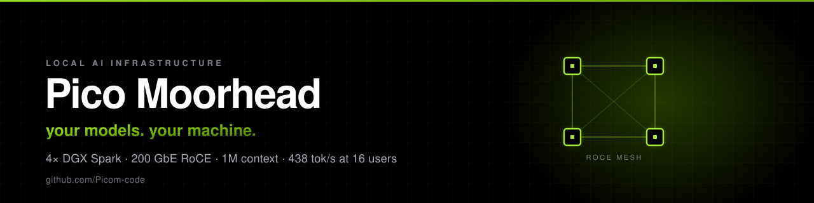

  

 

## Two things I've built

### [pico-dgx-ds4](https://github.com/Picom-code/pico-dgx-ds4)

DeepSeek-V4.1-Flash on four DGX Sparks, meshed over 200 GbE RoCE. Hand-written CUDA kernels,
a Rust OpenAI-compatible front-end, and a 1M-token context window on hardware that fits under a desk.

|  |  |
|---|---|
| aggregate | **438 tok/s** at 16 concurrent users |
| single stream | **80–138 tok/s** |
| cold 14k prompt | ~35 s |

### [ezlm](https://github.com/Picom-code/ezlm)

Your own model, running on your own computer. One click, no cloud, no API keys, no per-token bill.

**[picom-code.github.io/ezlm](https://picom-code.github.io/ezlm/)**

---

**Day job** — technical marketing engineer at NVIDIA: AI agents, MCP, NeMo Agent Toolkit, Brev.

`cuda` · `python` · `rust` · `typescript` · `pytorch`
